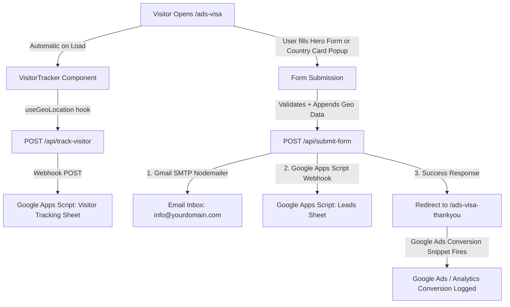

# Ads Visa Landing Page — Complete Architecture & Replication Guide

This document contains the complete technical blueprint, UI components, copywriting, form logic, visitor tracking, backend API routes, and standalone Google Apps Scripts for the **`ads-visa`** landing page (`https://www.eazyvisas.com/ads-visa`).

You can use this guide to replicate the exact same setup for **JM Visa** (`https://www.jmvisaservices.com`) or any other brand/page.

---

## Table of Contents
1. [Architecture & Data Flow Overview](#1-architecture--data-flow-overview)
2. [Frontend Page Structure & Components](#2-frontend-page-structure--components)
3. [Form Specifications & Geo-Location Data](#3-form-specifications--geo-location-data)
4. [Backend API Routes](#4-backend-api-routes)
5. [Google Apps Script 1: Consultation Leads Form (Dedicated)](#5-google-apps-script-1-consultation-leads-form-dedicated)
6. [Google Apps Script 2: Visitor & Pincode Tracking (Dedicated)](#6-google-apps-script-2-visitor--pincode-tracking-dedicated)
7. [Thank You / Conversion Page & Google Ads Tracking](#7-thank-you--conversion-page--google-ads-tracking)
8. [JM Visa Brand Adaptation & Deployment Checklist](#8-jm-visa-brand-adaptation--deployment-checklist)

---

## 1. Architecture & Data Flow Overview



---

## 2. Frontend Page Structure & Components

### Page Route: `src/app/(home)/ads-visa/page.js`
The page consists of 6 core sections:

1. **Hero Section (`AdsVisaHero.jsx`)**:
   - **Main Heading:** *"Expert Visa Consultants for UK, US, Schengen & Australia"* (interactive animated text).
   - **Subheading/Copy:** *"Get visa consultation for tourist and business travel to the UK, US, Schengen (Europe) and Australia with a simple, step-by-step process and fast WhatsApp support whenever you need clarity. We're an independent consultancy (not a government website), and we don't promise approvals; final decisions are always made by the relevant authorities."*
   - **Trust Badges:** WhatsApp Support, Quick Response, 10+ Years Experience, Multi-Country Support.
   - **Embedded Lead Form:** `FormComponent.jsx` with destination path `/ads-visa-thankyou`.

2. **Features / Value Proposition Cards (4 Cards)**:
   - **Expert Consultants:** 10+ years of experience with expert visa consultants guiding you through the entire application process from start to approval.
   - **100+ Countries:** Visa assistance for 100+ destinations worldwide (including UK, USA, Schengen/Europe, and Australia).
   - **Fast Processing:** Quick turnaround and priority coordination so your documents can be verified and submitted without avoidable delays.
   - **24/7 WhatsApp Support:** Instant WhatsApp support anytime, anywhere. Get quick replies and guidance whenever you need help.

3. **Popular Country Cards (`CountryCardsSection.jsx`)**:
   - **4 Country Cards:**
     - **United Kingdom (UK)**: Flag (`/images/flags/gb.webp`), Landmark Image (`Big Ben...`), Types: `Tourist Visa`, `Business Visa`, Processing: `15-20 Days`.
     - **United States (USA)**: Flag (`/images/flags/us.webp`), Landmark Image (`Tourist Places in United States...`), Types: `Tourist Visa`, `Business Visa`, Processing: `30-60 Days`.
     - **Schengen (Europe)**: Flag (`/images/flags/eu.png`), Landmark Image (`Colosseum in Italy...`), Types: `Tourist Visa`, `Business Visa`, Processing: `15-20 Days`.
     - **Australia**: Flag (`/images/flags/au.webp`), Landmark Image (`Sydney Opera House...`), Types: `Tourist Visa`, `Business Visa`, Processing: `15-20 Days`.
   - **Clicking any card:** Opens the modal popup `CountryCardPopupForm.jsx` pre-filled with the selected destination country.

4. **Client Testimonials & Google Review Carousel**:
   - **Rating Badge:** `5.0 out of 5 based on 50 reviews` with Google logo (`FcGoogle`).
   - **Auto-scrolling carousel** with 5 customer reviews, customer avatar image, date, 5-star rating, and review comment.

5. **Our Story / About Brand Section**:
   - **Mission Copy:** *"Visa applications feel stressful because requirements vary and small mistakes can cause delays. We built [Brand Name] to simplify the journey with clear guidance, practical checklists, and responsive support. If you're unsure what applies to your case, we help you understand the process and prepare with confidence without overpromising results."*

6. **Help / Contact CTA Banner**:
   - **WhatsApp CTA Button:** Direct link to `https://wa.me/<PhoneNumber>`.
   - **Call Support Button:** Direct `tel:<PhoneNumber>`.

---

## 3. Form Specifications & Geo-Location Data

### Form Fields (Hero Form & Popup Modal Form)
| Field Name | Type | Options / Constraints | Required |
| :--- | :--- | :--- | :--- |
| `firstName` | Text | Trimmed text string | Yes |
| `lastName` | Text | Trimmed text string | Yes |
| `email` | Email | Regex validation `^[^\s@]+@[^\s@]+\.[^\s@]+$` | Yes |
| `countryCode` | Dropdown | Default `+91`, country code picker | Yes |
| `phone` | Tel / Number | 10 to 15 digits | Yes |
| `visaType` | Dropdown | `Tourist Visa`, `Business Visa`, `End-to-End Visa Assistance`, `Dummy Hotel Booking`, `Dummy Flight Booking` | Yes |
| `country` | Dropdown | List of 195 countries | Yes |
| `isAccepted` | Checkbox | Terms and Conditions agreement checkbox | Yes |

### Auto-Injected Geo & Tracking Metadata (Added to Submission Body)
```javascript
{
  ...formData,
  phone: "+91 9876543210",
  googleSheetsPhone: "919876543210",
  country: "United Kingdom",
  visaType: "Tourist Visa",
  formSource: "ads-visa",
  from: "ads-visa",
  fromCategory: "ads-visa",
  userLocation: "Mumbai, Maharashtra, India", // Auto fetched from IP
  userPincode: "400001",                      // Auto fetched from IP
  userIp: "103.xxx.xxx.xxx"                   // Auto fetched
}
```

---

## 4. Backend API Routes

### 4.1. Lead Submission API: `src/app/api/submit-form/route.js`
Handles lead deduplication, IST timestamps, Gmail SMTP notifications, and Google Sheets webhook submission:

```javascript
import nodemailer from 'nodemailer';
import { sendToGoogleSheets } from '../../../lib/googleSheetsClient';

export const dynamic = 'force-dynamic';

// IST Indian Standard Time Formatter
const getIndianTime = () => {
  const now = new Date();
  const utcTime = now.getTime();
  const istOffset = 5.5 * 60 * 60 * 1000;
  const istTime = new Date(utcTime + istOffset);

  const year = istTime.getUTCFullYear();
  const month = String(istTime.getUTCMonth() + 1).padStart(2, '0');
  const day = String(istTime.getUTCDate()).padStart(2, '0');

  let hours = istTime.getUTCHours();
  const minutes = String(istTime.getUTCMinutes()).padStart(2, '0');
  const seconds = String(istTime.getUTCSeconds()).padStart(2, '0');

  const ampm = hours >= 12 ? 'PM' : 'AM';
  hours = hours % 12 || 12;
  const displayHours = String(hours).padStart(2, '0');

  return `${day}/${month}/${year}, ${displayHours}:${minutes}:${seconds} ${ampm} (IST)`;
};

export const POST = async (req) => {
  try {
    const {
      firstName,
      lastName,
      email,
      phone,
      googleSheetsPhone,
      country,
      visaType,
      formSource,
      countryCode,
      from,
      userLocation,
      userPincode,
      userIp,
    } = await req.json();

    const name = `${firstName || ''} ${lastName || ''}`.trim();

    if (!firstName || !lastName || !email || !phone || !country || !visaType) {
      return new Response(
        JSON.stringify({ error: 'All fields are required!' }),
        { status: 400, headers: { 'Content-Type': 'application/json' } }
      );
    }

    const indianTime = getIndianTime();

    // 1. Send Email Notification via Nodemailer
    try {
      const transporter = nodemailer.createTransport({
        service: 'gmail',
        auth: {
          user: process.env.NEXT_PUBLIC_EMAIL_USER,
          pass: process.env.NEXT_PUBLIC_EMAIL_APP_PASSWORD,
        },
      });

      await transporter.sendMail({
        from: `"Visa Consultation Request" <${process.env.NEXT_PUBLIC_EMAIL_USER}>`,
        to: process.env.NEXT_PUBLIC_EMAIL_RECEIVER,
        subject: `New Visa Consultation Request - ${visaType} - ${country}`,
        html: `
          <h2>New Visa Consultation Lead</h2>
          <p><strong>Name:</strong> ${name}</p>
          <p><strong>Email:</strong> ${email}</p>
          <p><strong>Phone:</strong> ${phone}</p>
          <p><strong>Visa Type:</strong> ${visaType}</p>
          <p><strong>Country:</strong> ${country}</p>
          <p><strong>Source:</strong> ${formSource || 'ads-visa'}</p>
          <p><strong>Location:</strong> ${userLocation || 'Unknown'}</p>
          <p><strong>Pincode:</strong> ${userPincode || 'Unknown'}</p>
          <p><strong>IP:</strong> ${userIp || 'Unknown'}</p>
          <p><strong>Time:</strong> ${indianTime}</p>
        `,
      });
    } catch (emailErr) {
      console.error('Email send failed:', emailErr?.message);
    }

    // 2. Send to Google Sheets Webhook
    await sendToGoogleSheets(
      {
        firstName: firstName || '',
        lastName: lastName || '',
        name,
        email: email || '',
        phone: googleSheetsPhone || phone || '',
        countryCode: countryCode || '',
        country: country || '',
        visaType: visaType || '',
        formSource: formSource || 'ads-visa',
        userLocation: userLocation || '',
        userPincode: userPincode || '',
        userIp: userIp || '',
        submittedAt: indianTime,
      },
      'visa consultation form'
    );

    return new Response(
      JSON.stringify({ success: true, message: 'Form submitted successfully!' }),
      { status: 200, headers: { 'Content-Type': 'application/json' } }
    );
  } catch (error) {
    return new Response(
      JSON.stringify({ success: false, message: error.message }),
      { status: 500, headers: { 'Content-Type': 'application/json' } }
    );
  }
};
```

---

### 4.2. Visitor Tracking API: `src/app/api/track-visitor/route.js`

```javascript
const WEBHOOK_URL = process.env.NEXT_PUBLIC_VISITOR_TRACKING_WEBHOOK_URL || '';

const getIndianTime = () => {
  const now = new Date();
  const ist = new Date(now.getTime() + 5.5 * 60 * 60 * 1000);
  const d = String(ist.getUTCDate()).padStart(2, '0');
  const m = String(ist.getUTCMonth() + 1).padStart(2, '0');
  const y = ist.getUTCFullYear();
  let h = ist.getUTCHours();
  const min = String(ist.getUTCMinutes()).padStart(2, '0');
  const sec = String(ist.getUTCSeconds()).padStart(2, '0');
  const ampm = h >= 12 ? 'PM' : 'AM';
  h = h % 12 || 12;
  return `${d}/${m}/${y}, ${String(h).padStart(2, '0')}:${min}:${sec} ${ampm} (IST)`;
};

export async function POST(req) {
  try {
    if (!WEBHOOK_URL) return Response.json({ skipped: true });

    const { ip, city, region, country, pincode, pageUrl, referrer, userAgent } = await req.json();

    await fetch(WEBHOOK_URL, {
      method: 'POST',
      headers: { 'Content-Type': 'application/json' },
      body: JSON.stringify({
        timestamp: getIndianTime(),
        ip,
        city,
        region,
        country,
        pincode,
        pageUrl,
        referrer: referrer || 'Direct',
        userAgent,
      }),
    });

    return Response.json({ success: true });
  } catch (err) {
    console.error('track-visitor error:', err);
    return Response.json({ success: false });
  }
}
```

---

## 5. Google Apps Script 1: Consultation Leads Form (Dedicated)

Create a **new Google Sheet** named `JM_Visa_Consultation_Leads`. Open **Extensions > Apps Script**, paste this code, and deploy as a **Web App** (Access: *Anyone*).

```javascript
/**
 * DEDICATED GOOGLE APPS SCRIPT: FORM LEADS
 * Deployed as Web App with Execute As: "Me" and Who Has Access: "Anyone"
 */
function doPost(e) {
  var lock = LockService.getScriptLock();
  try {
    lock.waitLock(30000); // Wait up to 30 seconds for lock
    
    var sheet = SpreadsheetApp.getActiveSpreadsheet().getActiveSheet();
    var rawData = e.postData.contents;
    var data = JSON.parse(rawData);

    // Auto-create header row if sheet is brand new
    if (sheet.getLastRow() === 0) {
      sheet.appendRow([
        "Submitted At (IST)",
        "Full Name",
        "First Name",
        "Last Name",
        "Email",
        "Phone",
        "Country Code",
        "Destination Country",
        "Visa Type",
        "Form Source",
        "User Location",
        "Pincode",
        "IP Address"
      ]);
      
      // Style header
      var headerRange = sheet.getRange(1, 1, 1, 13);
      headerRange.setBackground("#2563EB");
      headerRange.setFontColor("#FFFFFF");
      headerRange.setFontWeight("bold");
    }

    // Append lead row
    sheet.appendRow([
      data.submittedAt || new Date().toLocaleString("en-IN", { timeZone: "Asia/Kolkata" }),
      data.name || ((data.firstName || "") + " " + (data.lastName || "")).trim(),
      data.firstName || "",
      data.lastName || "",
      data.email || "",
      data.phone || data.googleSheetsPhone || "",
      data.countryCode || "",
      data.country || data.countryName || "",
      data.visaType || data.serviceSelected || "",
      data.formSource || data.from || "ads-visa",
      data.userLocation || "",
      data.userPincode || "",
      data.userIp || ""
    ]);

    return ContentService.createTextOutput(JSON.stringify({
      status: "success",
      message: "Lead recorded successfully"
    })).setMimeType(ContentService.MimeType.JSON);

  } catch (error) {
    return ContentService.createTextOutput(JSON.stringify({
      status: "error",
      message: error.toString()
    })).setMimeType(ContentService.MimeType.JSON);
  } finally {
    lock.releaseLock();
  }
}
```

---

## 6. Google Apps Script 2: Visitor & Pincode Tracking (Dedicated)

Create a **second Google Sheet** named `JM_Visa_Visitor_Tracking`. Open **Extensions > Apps Script**, paste this code, and deploy as a **Web App** (Access: *Anyone*).

```javascript
/**
 * DEDICATED GOOGLE APPS SCRIPT: VISITOR & PINCODE TRACKING
 * Deployed as Web App with Execute As: "Me" and Who Has Access: "Anyone"
 */
function doPost(e) {
  var lock = LockService.getScriptLock();
  try {
    lock.waitLock(30000);
    
    var sheet = SpreadsheetApp.getActiveSpreadsheet().getActiveSheet();
    var data = JSON.parse(e.postData.contents);

    // Auto-create header row if sheet is brand new
    if (sheet.getLastRow() === 0) {
      sheet.appendRow([
        "Visit Time (IST)",
        "IP Address",
        "Pincode",
        "City",
        "Region / State",
        "Country",
        "Page URL",
        "Referrer",
        "Browser User-Agent"
      ]);
      
      // Style header
      var headerRange = sheet.getRange(1, 1, 1, 9);
      headerRange.setBackground("#059669");
      headerRange.setFontColor("#FFFFFF");
      headerRange.setFontWeight("bold");
    }

    // Append visitor row
    sheet.appendRow([
      data.timestamp || new Date().toLocaleString("en-IN", { timeZone: "Asia/Kolkata" }),
      data.ip || "Unknown",
      data.pincode || "Unknown",
      data.city || "Unknown",
      data.region || "Unknown",
      data.country || "Unknown",
      data.pageUrl || "",
      data.referrer || "Direct",
      data.userAgent || ""
    ]);

    return ContentService.createTextOutput(JSON.stringify({
      status: "success",
      message: "Visitor tracked successfully"
    })).setMimeType(ContentService.MimeType.JSON);

  } catch (error) {
    return ContentService.createTextOutput(JSON.stringify({
      status: "error",
      message: error.toString()
    })).setMimeType(ContentService.MimeType.JSON);
  } finally {
    lock.releaseLock();
  }
}
```

---

## 7. Thank You / Conversion Page & Google Ads Tracking

### Path: `src/app/(home)/ads-visa-thankyou/page.js`
When users submit the form, they are redirected to `/ads-visa-thankyou`. This page triggers the Google Ads Conversion tag and displays confirmation details.

```jsx
"use client";
import { useEffect } from 'react';
import { FaCheckCircle, FaPhone, FaEnvelope, FaClock } from 'react-icons/fa';
import Link from 'next/link';
import Script from 'next/script';

export default function AdsVisaThankYouPage() {
  useEffect(() => {
    document.title = 'Thank You | Visa Consultation Confirmation';
  }, []);

  return (
    <div className="min-h-screen bg-gradient-to-b from-blue-50 to-white pt-12">
      {/* Insert your Google Ads Conversion Snippet here */}
      <Script id="ads-visa-conversion" strategy="afterInteractive">
        {`gtag('event', 'conversion', {
          'send_to': 'AW-XXXXXXXXX/YYYYYYYYYY',
          'value': 1.0,
          'currency': 'INR'
        });`}
      </Script>

      <div className="max-w-4xl mx-auto px-4 text-center">
        <div className="mx-auto flex items-center justify-center h-20 w-20 rounded-full bg-green-100 mb-6">
          <FaCheckCircle className="h-12 w-12 text-green-600" />
        </div>
        <h1 className="text-3xl font-extrabold text-gray-900 sm:text-4xl">
          Thank You for Your Visa Consultation Request!
        </h1>
        <p className="mt-3 text-lg text-gray-600">
          Our visa experts will call you shortly to assist with your requirements.
        </p>

        {/* 3 Status Cards */}
        <div className="grid grid-cols-1 md:grid-cols-3 gap-6 mt-10 text-left">
          <div className="bg-white p-6 rounded-xl shadow-md border border-gray-100">
            <FaClock className="h-7 w-7 text-blue-600 mb-3" />
            <h3 className="font-semibold text-gray-900 mb-1">What to Expect</h3>
            <p className="text-sm text-gray-600">Our expert will call you within 30 minutes.</p>
          </div>

          <div className="bg-white p-6 rounded-xl shadow-md border border-gray-100">
            <FaPhone className="h-7 w-7 text-blue-600 mb-3" />
            <h3 className="font-semibold text-gray-900 mb-1">Call Support</h3>
            <p className="text-sm text-gray-600">+91 XXXXXXXXXX</p>
          </div>

          <div className="bg-white p-6 rounded-xl shadow-md border border-gray-100">
            <FaEnvelope className="h-7 w-7 text-blue-600 mb-3" />
            <h3 className="font-semibold text-gray-900 mb-1">Email Us</h3>
            <p className="text-sm text-gray-600">info@yourbrand.com</p>
          </div>
        </div>

        <div className="mt-8">
          <Link href="/" className="inline-block px-6 py-3 bg-blue-600 text-white rounded-lg font-medium hover:bg-blue-700">
            Back to Home
          </Link>
        </div>
      </div>
    </div>
  );
}
```

---

## 8. JM Visa Brand Adaptation & Deployment Checklist

When replicating this page for JM Visa:

### Step 1: Update Environment Variables (`.env.local`)
```env
NEXT_PUBLIC_EMAIL_USER="your-gmail@gmail.com"
NEXT_PUBLIC_EMAIL_APP_PASSWORD="your-gmail-16-char-app-password"
NEXT_PUBLIC_EMAIL_RECEIVER="info@jmvisaservices.com"

# Webhook 1: Form Leads Google Sheet
NEXT_PUBLIC_GOOGLE_SHEETS_WEBHOOK_URL="https://script.google.com/macros/s/YOUR_LEADS_SCRIPT_ID/exec"

# Webhook 2: Visitor & Pincode Tracking Google Sheet
NEXT_PUBLIC_VISITOR_TRACKING_WEBHOOK_URL="https://script.google.com/macros/s/YOUR_VISITOR_SCRIPT_ID/exec"
```

### Step 2: Replace Brand Assets & Copy
* **Brand Name:** Replace `Eazy Visas` with `JM Visa` / `JM Visa Services`.
* **Phone / WhatsApp Number:** Update `+918850146905` to your JM Visa business phone.
* **Support Email:** Update `info@eazyvisas.com` to `info@jmvisaservices.com`.
* **Logo Images:** Replace `/logo/logo-white.png` with JM Visa logo.
* **Google Ads Conversion Snippet:** Update Google Tag `AW-XXXXXXXXX/YYYYYYYY` on `/ads-visa-thankyou/page.js`.

### Step 3: Google Sheets Deployment (2 Separate Sheets)
1. Deploy **Leads Sheet Webhook** using the script in [Section 5](#5-google-apps-script-1-consultation-leads-form-dedicated).
2. Deploy **Visitor Tracking Webhook** using the script in [Section 6](#6-google-apps-script-2-visitor--pincode-tracking-dedicated).
3. Ensure both Apps Scripts are set to:
   - **Execute as:** `Me (your email)`
   - **Who has access:** `Anyone`
